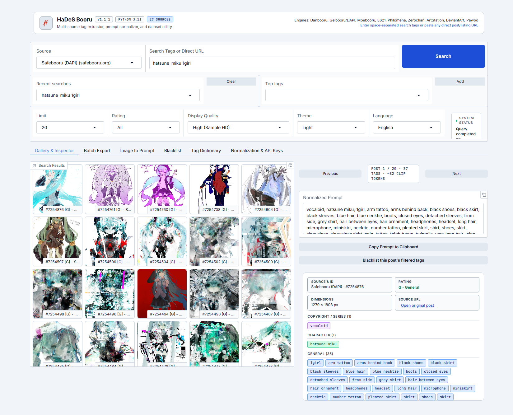
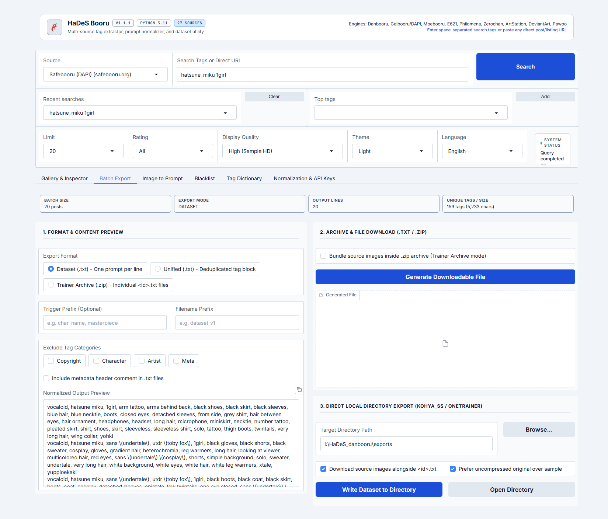
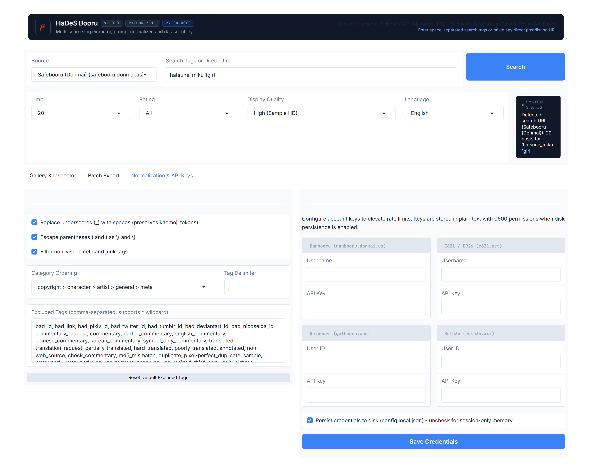
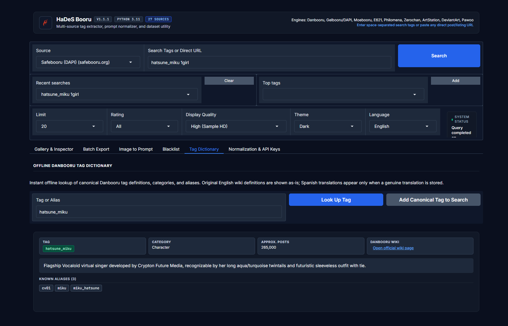
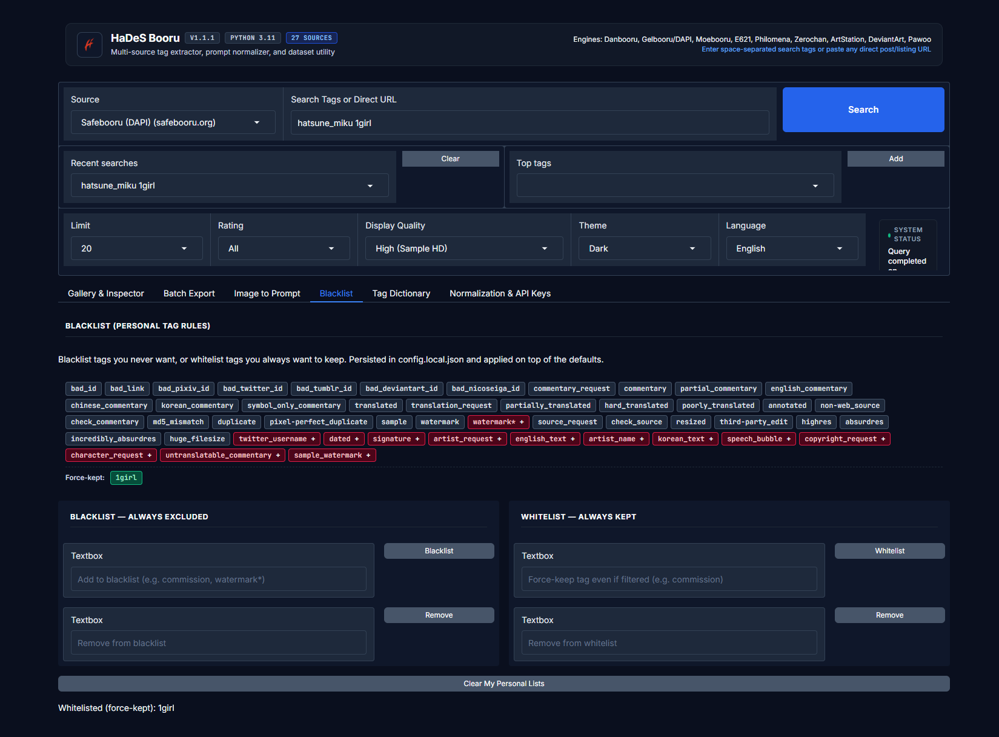

# HaDeS Booru v1.1.1

[](https://www.python.org/downloads/)
[](LICENSE)
[](https://github.com/Devildonia/HaDeS-Booru/actions/workflows/ci.yml)

Multi-source tag extractor, semantic prompt normalizer, offline tag dictionary, and dataset utility built with Python 3.11 and Gradio.

## Features

- **Native HTTP Engine**: Requests and image downloads execute through Python (`httpx`) with domain-specific headers (`User-Agent` and `Referer`) and automatic backoff.
- **28 Supported Sources Across 7 API Families**:
  - **Danbooru v2**: `danbooru.donmai.us`, `safebooru.donmai.us`, `hijiribe.donmai.us`, `sonohara.donmai.us`, `aibooru.online`, `booru.allthefallen.moe`
  - **Gelbooru / DAPI**: `safebooru.org`, `gelbooru.com`, `rule34.xxx`, `rule34.us`, `tbib.org`, `xbooru.com`, `realbooru.com`
  - **Moebooru**: `konachan.com`, `konachan.net`, `yande.re`, `sakugabooru.com`, `lolibooru.moe`
  - **E621 / E926**: `e621.net`, `e926.net`
  - **Philomena**: `derpibooru.org`, `furbooru.org` (v1.1.1)
  - **Zerochan**: `zerochan.net`
  - **Art Platforms & OpenGraph**: `deviantart.com` (RSS), `artstation.com`, `pawoo.net`, `e-hentai.org`, `booru.io`
- **Offline Tag Dictionary**: Built-in SQLite dictionary (`hades_booru/tag_dictionary/`) with millisecond exact-match lookup, alias resolution (`miku` -> `hatsune_miku`), Danbooru wiki links, and strict bilingual definitions (English original + curated Spanish translation where genuinely defined; never auto-translated). Includes a standalone CLI importer (`python -m hades_booru.tag_dictionary.importer`) to fetch expanded catalogs from the Danbooru API.
- **3-Layer DAPI Tag Categorization**: Gelbooru / DAPI sources combine expanded suffix heuristics (explicit exemptions for `_(color)`, `_(pose)`, `_(position)`, `_(style)`, `_(clothing)`, `_(expression)`, `_(object)`, etc.), offline Tag Dictionary batch resolution for known `artist` / `copyright` / `character` tags, and an optional in-memory LRU cache (`DapiTagCategoryCache`) for the DAPI tag index endpoint. Residual edge cases (brand-new unindexed tags with ambiguous parentheses) fall back to `character` or `general`.
- **Configurable Display Quality**: Switch between `Low (180p)`, `Medium (720p)`, `High (Sample HD, default)`, `Original (Uncompressed)`, and `Text Only`.
- **Semantic Tag Normalization**: Configurable category ordering (`copyright > character > artist > general > meta`), kaomoji preservation (`^_^`, `(o_o)`), underscore replacement, parenthesis escaping, and wildcard junk filtering.
- **Per-Session Personal Lists under `--share`**: Personal blacklist, whitelist, and default junk overrides stay isolated in per-session memory (`gr.State`) when launched with `--share`, while persisting to `config.local.json` in normal local mode.
- **Batch Dataset Export**: Export as consolidated `.txt` (1 prompt per line or unified tag block), `.zip` trainer caption archive, or write image + `<id>.txt` pairs directly to a local directory.
- **Selectable Theme & Offline Fonts**: Switch between `Dark`, `Light`, and `System (Auto)` themes (WCAG AA >= 4.5:1 contrast across all tokens and category chips), persisted in `config.local.json`, with locally bundled `Inter` and `JetBrains Mono` WOFF2 fonts (zero external font requests).
- **Bilingual Interface**: English (`en`, default) and Spanish (`es`), persisted in `config.local.json`.

## Screenshots

> Captured against **Safebooru (DAPI)** (safe-only source) — `hatsune_miku 1girl`, 20 results. Shots 1-3 in the Light theme, shots 4-5 in the Dark theme.

| Gallery & Inspector | Batch Export |
|---|---|
|  |  |

**Normalization & API Keys**



**Tag Dictionary (Dark theme)**



**Blacklist (Dark theme)**



## Project Structure

```text
HaDeS-Booru/
├── app.py                        # Entry point (http://127.0.0.1:7863)
├── start.bat                     # Windows launcher script
├── start.sh                      # Linux / macOS launcher script
├── requirements.txt              # Runtime dependencies (range pins)
├── requirements.lock             # Locked dependency tree (reproducible installs, pip-audit in CI)
├── requirements-dev.txt          # Dev dependencies (pytest, pytest-cov, ruff, mypy)
├── pyproject.toml                # Project metadata, Ruff, Pytest, and Mypy configuration
├── RELEASES.md                   # Version-by-version release notes, design decisions, and conventions (v1.0.0 -> latest)
├── ROADMAP.md                    # Forward-looking plan: candidate Booru sources, accepted limitations, conventions
├── LICENSE                       # MIT license
├── hades_booru/                  # Core package
│   ├── models.py                 # Pydantic v2 domain models
│   ├── config.py                 # Persistent JSON configuration manager
│   ├── i18n.py                   # English and Spanish localization strings
│   ├── http_client.py            # HTTPX client with domain header routing
│   ├── image_cache.py            # Bounded disk image cache for gallery rendering
│   ├── metadata_extractor.py     # Local PNG/JPEG/WebP prompt & workflow extractor
│   ├── normalizer.py             # Tag sanitizer and semantic prompt builder
│   ├── exporter.py               # TXT, ZIP, and local folder dataset writer
│   ├── demo_data.py              # Offline sample dataset
│   ├── adapters/                 # Source adapters, shared pagination, and URL registry
│   ├── tag_dictionary/           # Offline SQLite Tag Dictionary service, seed catalog & CLI importer
│   └── ui/                       # Modular Gradio Blocks layout, handlers, state store, theme & fonts
│       ├── layout.py             # Gradio Blocks assembly & event wiring
│       ├── handlers.py           # Pure UI helper functions (history, top tags, prompt assembly)
│       ├── state.py              # SessionLists & PersonalListStore (--share isolation)
│       ├── desktop.py            # Native folder picker & OS file-explorer integration
│       ├── components.py         # Semantic HTML renderers (header, inspector, dictionary card)
│       ├── theme.py              # Dark/Light/System CSS variables, local WOFF2 @font-face & theme
│       └── assets/fonts/         # Bundled Inter & JetBrains Mono WOFF2 + OFL.txt
├── docs/screenshots/             # README screenshots (Safebooru, SFW)
└── tests/                        # Automated test suite (Pytest)
```

## Quick Start

### 1. Install Dependencies
```powershell
pip install -r requirements.txt
```

For a fully reproducible install with the exact audited dependency tree:

```powershell
pip install -r requirements.lock
```

### 2. Run the Application
- **Windows**: double-click `start.bat`
- **Linux / macOS**: `./start.sh`
- **Any OS**:
```bash
python app.py
```
The web interface listens on `http://127.0.0.1:7863` (local only by default).

> **Port note**: the default port is `7863`, chosen to avoid clashing with Stable Diffusion WebUI / Forge (`7860` / `7861`) and ComfyUI (`8188`). If that port is already in use, the app automatically probes the next sequential ports and binds the first free one, so the UI always comes up. The actually-chosen URL is printed to the console on launch.

> **Security note**: `python app.py --share` exposes the interface through a public Gradio tunnel. Personal tag lists are automatically isolated per session in `--share` mode, but avoid this flag if you have loaded personal API credentials.
>
> **Private-network guard**: requests to private, loopback, reserved or link-local addresses are blocked by default (including on every redirect hop). If the app must reach a self-hosted board on your LAN, set `HADES_ALLOW_PRIVATE_HOSTS=1`.

### 3. Run Tests and Linter (development)
```bash
pip install -r requirements-dev.txt
python -m pytest
python -m ruff check .
python -m mypy hades_booru app.py
```

### 4. Optional: Build the Offline Tag Dictionary from Danbooru

The app ships with a curated offline seed catalog (38 foundational tags) so the Tag Dictionary
works immediately with no network. To grow it to the **1,000 most popular Danbooru tags** (with
live wiki definitions and canonical aliases) into the local SQLite file, run the one-off importer:

```powershell
python -m hades_booru.tag_dictionary.importer --top 1000
```

Useful options:

| Flag | Default | Description |
|------|---------|-------------|
| `--top N` | `1000` | Import the `N` most popular tags (ranked by post count). |
| `--skip-wiki` | off | Faster first pass: fetch tags + aliases only, skip wiki bodies. |
| `--resume` | on | Skip tags already stored locally (re-runs only fetch what is new). |
| `--no-resume` | off | Re-fetch wiki/aliases even for tags already stored. |
| `--seed-only` | off | Only seed the local DB with the built-in catalog (no network). |

> **Rate-limit note**: the importer paces its requests to respect Danbooru's public limit
> (~2 req/s unauthenticated, ~4 req/s with an API key) and prints an estimated duration before
> starting. A full 1,000-tag import makes ~2,000 API calls and takes roughly 15–20 minutes
> unauthenticated, or ~8 minutes with a Danbooru API key (add one in Settings for ~2x speed).
> It is resumable and fault-isolated: a single failing tag is logged and skipped without aborting
> the run, and a summary reports exactly how many tags, wiki bodies, and aliases were imported.
> The importer never runs automatically at app startup.

## Release Notes

Full version-by-version history, design decisions, and release conventions: see [RELEASES.md](RELEASES.md).  
Forward-looking plan, including the researched-but-not-yet-integrated Booru candidates: see [ROADMAP.md](ROADMAP.md).

## License

Distributed under the [MIT License](LICENSE).
